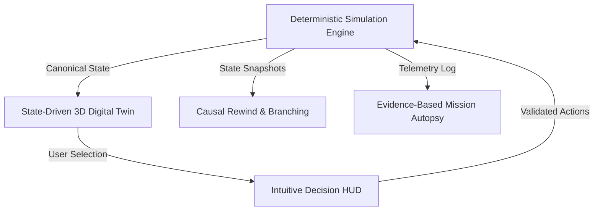

# 01 — Product Vision & Strategic Positioning

**Document Status:** Approved Architecture Reference  
**Audience:** All Team Members, LUMEN 2.0 Hackathon Jury, Educational Stakeholders  
**Author:** Engineering Team Lead

---

## 1. Executive Vision

**MissionLab** is an interactive, browser-based 3D Mars mission training platform that teaches secondary and post-secondary students how complex, life-critical extraterrestrial habitats function.

Learners assume the role of an acting Mars outpost commander during operational crises. Instead of answering static quiz questions or following rigid branching dialogue trees, students interact directly with a state-driven 3D digital twin of a Mars base. They inspect subsystems, allocate scarce electrical power, manage atmospheric and water recycling balances, and observe the immediate and delayed consequences of their engineering trade-offs.

When a crisis escalates into failure, MissionLab avoids generic "Game Over" screens. Instead, an evidence-based **Mission Autopsy** dissects the causal chain of events, explains the underlying scientific and engineering principles, and invites the learner to **Rewind** time to any critical decision, change their operational policy, and verify the counterfactual outcome on the exact same deterministic physics engine.

---

## 2. The Educational Problem Today

### 2.1 The Educational Gap
Current space education and STEM software suffer from a persistent dichotomy:
1. **Oversimplified Gamified Toys:** Cartoonish apps or quiz platforms that reduce space exploration to factual recall (e.g., memorizing the mass of Mars or matching rocket stages). They offer zero insight into systemic trade-offs or operational resource dependencies.
2. **Professional Aerospace Tools:** Complex engineering software (e.g., NASA ECLSS simulation packages, Systems Tool Kit, OpenMDAO) that require advanced degrees in fluid dynamics, orbital mechanics, or thermodynamics, rendering them inaccessible to 12–18-year-old learners.

Young learners rarely discover *how* systems connect. They do not experience how an atmospheric dust storm reduces photovoltaic generation, how battery depletion limits water recovery distillation, how water shortfalls compromise electrolysis oxygen production, or how deferred maintenance on mechanical pumps triggers cascading colony-wide emergencies.

### 2.2 Why This Matters Beyond 2030
As humanity expands beyond low Earth orbit toward sustainable lunar settlements (Artemis Base Camp) and the first crewed Martian science stations (anticipated in the 2030s and 2040s), the nature of operational training must evolve:
- **Autonomous Crews:** Transmission delays between Mars and Earth (ranging from 4 to 24 minutes each way) mean Martian crews cannot rely on real-time Houston Mission Control intervention. They must possess holistic systems thinking and operational trade-off intuition.
- **Interdisciplinary Operators:** Future space settlement personnel will include geologists, biologists, medical officers, and agricultural specialists—not just test pilots. All must understand how their local decisions impact habitat survival.
- **STEM Pipeline:** Inspiring the next generation of aerospace engineers, environmental systems designers, and habitat architects requires experiential, exploratory learning platforms that make complex systems intuitively understandable.

---

## 3. Target Users & Buyer Personas

### 3.1 Primary Personas

```text
+-----------------------+-----------------------+-----------------------+
|  STUDENT LEARNER      |  STEM EDUCATOR        |  ACADEMY DIRECTOR     |
|  "Alex" (Age 15)      |  "Dr. Sarah Vance"    |  "Marcus Sterling"    |
+-----------------------+-----------------------+-----------------------+
| - Secondary student   | - High school physics | - Science museum /    |
| - High curiosity for  |   & space science     |   STEM camp director  |
|   space & technology  | - Wants hands-on      | - Needs high-impact   |
| - Dislikes rote drills|   systems activities  |   reusable programs   |
| - Needs clear causal  | - Needs objective     | - Evaluates cost per  |
|   feedback on failure |   student reasoning   |   student and repeat  |
| - Learns by doing     |   telemetry & debrief |   engagement value    |
+-----------------------+-----------------------+-----------------------+
```

### 3.2 Jobs-To-Be-Done (JTBD)

| Stakeholder | When... | I want to... | So that I can... |
|---|---|---|---|
| **Student** | Facing a habitat crisis in an interactive simulator | Make operational decisions and advance time | See the genuine physical consequences of my trade-offs rather than a pre-scripted answer. |
| **Student** | My habitat fails due to an engineering bottleneck | Review an evidence-based debrief and rewind | Understand where my reasoning broke down, fix the root cause, and succeed. |
| **Teacher** | Leading a unit on resource management & thermodynamics | Assign a repeatable mission scenario to a class cohort | Assess student systems-thinking skills, compare student strategies, and spark debate. |
| **Institution** | Organizing summer camps or STEM workshops | License an engaging, browser-based space simulation | Deliver a memorable astronaut training experience without purchasing expensive physical hardware. |

---

## 4. Product Differentiation

MissionLab combines four pillars that have never previously been integrated into an educational web application:



1. **State-Driven 3D Digital Twin:** The Three.js environment is not decorative backdrop art. Every mesh, material shader, lighting condition, and status marker is directly coupled to typed simulation telemetry.
2. **Deterministic Physics Engine:** Outpost physics run on a pure, frame-independent fixed-step TypeScript engine. Given the exact same inputs and decisions, the outcome is 100% reproducible.
3. **Causal Timeline Rewind:** Students can jump backward to any previous hour, branch their timeline, take an alternate decision (e.g., shedding science power instead of ignoring a pump leak), and compare the two divergent timelines.
4. **Mission Autopsy:** Instead of arbitrary pass/fail grading, the debrief algorithm reconstructs the causal chain from recorded engine events (e.g., *"Continuing greenhouse and research loads created a 4.4 kW deficit. Battery depleted at Hour 25; essential electrical supply became insufficient during the next interval, ending the mission at Hour 26"*).

---

## 5. Scope Boundaries & Honest Claims

To preserve academic integrity and align with the hackathon judging criteria:
- **Educational Simulation, Not NASA Telemetry:** MissionLab is a *digital-twin-style educational simulation*. It does not connect to live ISS or Martian spacecraft telemetry.
- **Calibrated Scientific Model, Not Certified Flight Software:** Numerical constants (e.g., crew oxygen consumption of 0.14 kg/h, water recycling rate of 0.42 L/h) are derived from NASA ECLSS literature and calibrated for educational gameplay, not for certified astronaut mission planning.
- **Deterministic Math, Not Ungrounded AI:** Mission outcomes are calculated by deterministic conservation equations, not hallucinated by generative language models.

---

## 6. Strategic Horizon: Hackathon MVP to SaaS

```text
Phase 0 (Current)       Phase 1 (Hackathon MVP)     Phase 2 (Educational SaaS)
-----------------       -----------------------     --------------------------
- Shared TS contracts   - Playable Mission 01       - Teacher dashboard
- Architecture specs    - 3D Mars Habitat           - Class roster management
- 6 Test fixtures       - The Red Storm crisis      - Curriculum mission catalog
- Minimal 3D slice      - Rewind & Branching        - Student performance analytics
- 15 Documentation files- Mission Autopsy debrief   - School subscription billing
```
