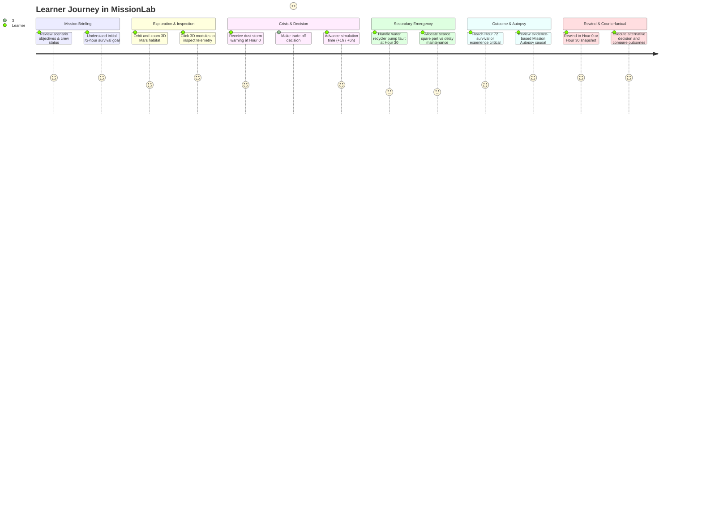

# 02 — Product Requirements Document (PRD)

**Version:** 1.0  
**Status:** Canonical Product Specification  
**Lead Author:** Technical Product Manager / Amina (Integration Lead)

---

## 1. Product Objectives

1. **Deliver a Flawless Hackathon MVP:** Provide a browser-based, interactive 3D Mars mission that executes the complete learner loop (Briefing -> Exploration -> Decision -> Telemetry Observation -> Outcome -> Autopsy -> Rewind).
2. **Ensure Uncompromising Technical Integrity:** Guarantee 100% deterministic physics execution where outcomes are mathematically provable and reproducible.
3. **Enable Scalable Architecture:** Architect shared contracts so that Kammoun (simulation), Habib (3D), and Amina (UI/UX) can work completely in parallel.

---

## 2. User Journey & Core Gameplay Loop

---

## 3. Functional Requirements

### 3.1 Habitat Subsystems (FR-100)
- **FR-101 (Module Inventory):** The application must model exactly 7 persistent habitat subsystems:
  1. `solar-array` (Photovoltaic power generation)
  2. `battery-bank` (Electrical energy buffer, 150 kWh capacity)
  3. `life-support` (ECLSS oxygen revitalization & trace contaminant scrubbing)
  4. `water-recycler` (Distillation & vapor compression recovery)
  5. `greenhouse` (Hydroponic crop cultivation & lighting)
  6. `research-lab` (Spectrometry & science computational arrays)
  7. `crew-habitat` (Living quarters & habitat heating)
- **FR-102 (Status Representation):** Every module must reflect one of 5 typed states: `operational`, `warning`, `degraded`, `offline`, or `repairing`.
- **FR-103 (Telemetry Parameters):** Every module must track enabled status, health score (0.0 to 1.0), power demand (kW), supplied power (kW), and repair hours remaining.

### 3.2 Simulation Engine & Physics (FR-200)
- **FR-201 (Fixed-Step Clock):** The simulation must advance in discrete, deterministic 1-hour time intervals (`dt = 1h`).
- **FR-202 (Power Balance):** Electrical energy stored in the battery must be governed by:
  $$\Delta \text{Battery} = (\text{Solar Generation} - \sum \text{Active Loads}) \times \Delta t$$
  Battery energy must be strictly clamped: $0 \le \text{Battery} \le 150\text{ kWh}$.
- **FR-203 (Water Balance):** Potable water inventory must be governed by:
  $$\Delta \text{Water} = (\text{Recovered Water} - \text{Crew Consumption}) \times \Delta t$$
- **FR-204 (Oxygen Balance):** Breathable oxygen inventory must be governed by:
  $$\Delta \text{Oxygen} = (\text{Generated Oxygen} - \text{Crew Respiration}) \times \Delta t$$
- **FR-205 (Maintenance Duration):** Equipment repair must not be instantaneous. Repairing the water recycler pump requires exactly 4 elapsed simulation hours and exactly 1 spare pump.

### 3.3 3D Mars Environment & Visualization (FR-300)
- **FR-301 (Module Selection):** Clicking any 3D habitat module must immediately select it and broadcast its `ModuleId` to the UI inspection panel.
- **FR-302 (Visual State Couplings):** Module status changes must alter 3D visual indicators (emissive beacons, material tints, and selection rings).
- **FR-303 (Atmospheric Response):** When `stormActive` is true, the environment fog density must increase, solar array lighting must dim, and ambient light must shift to a Martian rust palette.
- **FR-304 (Camera Bounds):** Camera orbit controls must prevent user clipping beneath the terrain plane ($y \ge 0$).

### 3.4 Decision Interface & Controls (FR-400)
- **FR-401 (Action Validation):** Actions must have explicit preconditions. Disabled actions must clearly display the exact rationale (e.g., *"Cannot repair: 0 spare pumps in inventory"*).
- **FR-402 (Trade-Off Visibility):** Every available action must clearly state its power delta (kW), resource cost, and expected mission impact.
- **FR-403 (Simulation Stepping):** The UI must provide +1h advance, +6h fast-forward, and mission reset controls.

### 3.5 Mission Autopsy & Rewind (FR-500)
- **FR-501 (Snapshot Capture):** The system must record immutable state snapshots at each simulation step and before each player action.
- **FR-502 (Deterministic Rewind):** Rewinding to hour $H$ must restore the exact state of resources, modules, and events at that hour, allowing the user to initiate an alternate branch.
- **FR-503 (Causal Log Generation):** The debrief screen must display an evidence-grounded cause chain extracted from logged transition events, not hallucinated text.
- **FR-504 (Branch Comparison):** The autopsy must allow side-by-side comparison between the original branch and the rewound branch (comparing final battery margin, water reserve, and crew survival).

---

## 4. Non-Functional Requirements (NFR)

- **NFR-1 (Determinism):** Two simulation runs starting with identical seeds and identical action histories must produce identical resource values to at least 4 decimal places.
- **NFR-2 (Rendering Performance):** The 3D viewport must sustain $\ge 45$ FPS on modern integrated GPUs (e.g., Apple M-series, Intel Iris Xe, AMD Radeon 600M).
- **NFR-3 (Load Time & Zero Backend):** The application must be statically deployable on Vercel or GitHub Pages, requiring zero database, server runtime, or external network calls during mission play.
- **NFR-4 (Accessibility):** Critical system states must never be communicated by color alone. Every warning and error must include text labels and numeric units.

---

## 5. Scope Prioritization Matrix

| Feature Capability | MVP Priority | Post-Hackathon Priority |
|---|---|---|
| 7 Habitat Subsystems with 3D models | **P0 (Must Have)** | Enhanced LODs |
| Deterministic Energy & ECLSS Math | **P0 (Must Have)** | Multi-gas atmospheric model |
| Mission 01: The Red Storm Crisis | **P0 (Must Have)** | Mission 02, 03, 04 catalog |
| Bi-directional Module Selection | **P0 (Must Have)** | First-person interior walk |
| Mission Autopsy & Causal Cause Chain | **P0 (Must Have)** | AI Socratic dialogue tutor |
| Rewind & Branch Comparison | **P0 (Must Have)** | Tree graph branch visualization |
| Teacher Portal & Class Roster | Out of Scope | **P1 (Core SaaS)** |
| Multi-tenant Authentication & Billing | Out of Scope | **P1 (Commercial)** |
| Real-time Multiplayer Habitat Roles | Out of Scope | **P2 (Long-term)** |

---

## Training Update (hands-on learning)

The product direction is now **hands-on, systems-based astronaut education**. Learners must diagnose and repair equipment, not just press repair buttons. Requirements, learning workflow, modes and acceptance criteria live in [16-TRAINING-DESIGN.md](16-TRAINING-DESIGN.md). The one-click repair (`REPAIR_WATER_RECYCLER`) remains only for legacy fixtures; with the training model active it is rejected and points to the maintenance procedure.
