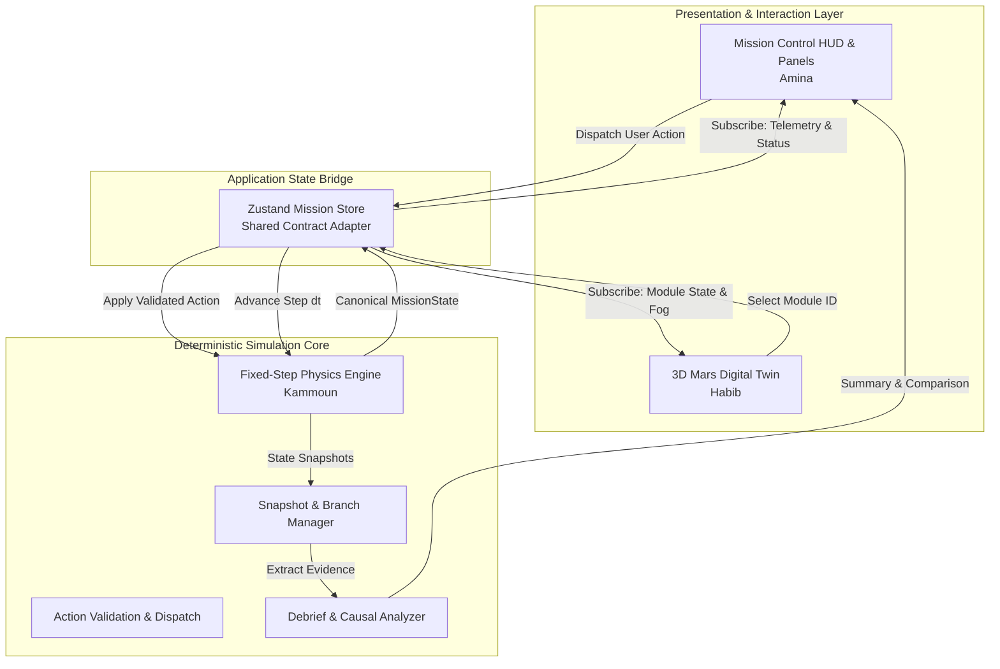
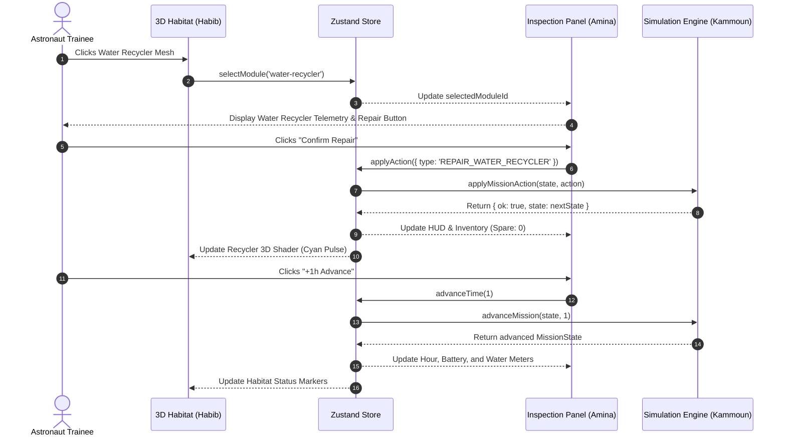

# 05 — System Architecture & Component Design

**Document Status:** Approved Architecture Reference  
**Lead Author:** Principal Software Architect

---

## 1. High-Level System Architecture

MissionLab enforces a clean architectural separation between **Mathematical Truth (Simulation Engine)**, **Application State Management (Zustand)**, **Visual Representation (Three.js / React Three Fiber)**, and **User Interaction (Next.js App Router UI)**.



---

## 2. Component Boundaries & Ownership

### 2.1 The Simulation Engine (`src/simulation/**`)
- **Owner:** Kammoun (Person 1)
- **Role:** Pure mathematical model and scenario truth.
- **Rules:**
  - Zero dependencies on React, Zustand, Three.js, or browser DOM APIs.
  - Receives `MissionState` and `MissionAction`, returns `ActionResult` or updated `MissionState`.
  - Exclusively owns state transitions, conservation balances, event triggers, and failure conditions.

### 2.2 The 3D Digital Twin (`src/features/habitat-3d/**`)
- **Owner:** Habib (Person 2)
- **Role:** Interactive 3D visualization of the Mars outpost.
- **Rules:**
  - Pure consumer of `MissionState` provided by props or Zustand.
  - Performs zero physics, resource drain, or game outcome calculations.
  - Emits user selection events via `onSelectModule(moduleId: ModuleId)`.
  - Updates material shaders, beacon lights, and storm fog directly from typed module statuses.

### 2.3 Mission Control UI & SaaS Experience (`src/app/**`, `src/features/mission-ui/**`, `src/features/debrief/**`)
- **Owner:** Amina (Person 3)
- **Role:** Product shell, resource telemetry HUD, subsystem inspector, action controls, and debrief.
- **Rules:**
  - Dispatches actions strictly to the Zustand store.
  - Renders resource meters, warning banners, and available actions according to engine contracts.
  - Presents the Mission Autopsy report using structured cause IDs generated by the engine.

---

## 3. Data Flow & State Lifecycle



---

## 4. Directory Structure & File Organization

```text
src/
├── app/                          # Next.js App Router root layout & main page
├── components/ui/                # Shared atomic UI components
├── features/
│   ├── habitat-3d/               # 3D Digital Twin (Habib)
│   │   ├── components/           # ModuleMesh, MarsEnvironment
│   │   └── HabitatScene.tsx      # R3F Canvas and controls
│   ├── mission-ui/               # Mission Control UI (Amina)
│   │   └── components/           # MissionHeader, ResourceHud, ModuleInspector, EventTimeline
│   └── debrief/                  # Mission Autopsy & Comparison (Amina)
│       └── components/           # AutopsyView, BranchComparisonView
├── simulation/                   # Pure TypeScript Simulation Engine (Kammoun)
│   ├── __tests__/                # Vitest contract and invariant tests
│   ├── fixtures/                 # 6 typed development mock states
│   ├── types.ts                  # Shared TypeScript contracts (Single Source of Truth)
│   ├── config.ts                 # Initial scenario configuration
│   ├── engine.ts                 # State transition & time advance methods
│   ├── actions.ts                # Action validation & preconditions
│   ├── events.ts                 # Scenario scheduled events
│   ├── history.ts                # Snapshot & branch forking logic
│   └── debrief.ts                # Summary & comparison metrics
└── state/
    └── missionStore.ts           # Central Zustand store bridge
```

---

## 5. Architectural Non-Goals for the MVP

To maintain high hackathon velocity and avoid unnecessary infrastructure failures:
- **No Node.js/NestJS Backend:** MVP runs completely browser-side.
- **No Database / PostgreSQL:** Snapshots and branch history are held in browser memory.
- **No External Cloud AI APIs:** Outcomes and autopsy explanations are deterministically generated from structured telemetry evidence.
- **No Heavy Physics Engine:** No Ammo.js or Rapier; rigid-body gravity is irrelevant to colony systems management.
