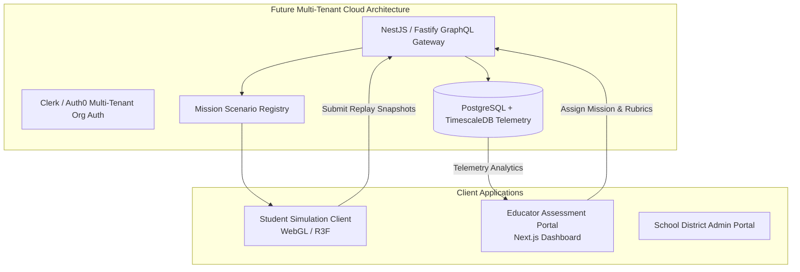

# 14 — Post-Hackathon SaaS Commercial Roadmap

**Document Status:** Strategic Commercial Roadmap  
**Scope Note:** All features in this document represent **post-hackathon product vision** and commercial hypotheses. They are not part of the immediate LUMEN 2.0 MVP build.

---

## 1. Commercial SaaS Vision

While the hackathon MVP proves the core single-mission learning loop, the commercial goal of MissionLab is to become the leading **browser-based STEM EdTech simulation platform for secondary schools, science academies, and university aerospace programs**.

```text
Hackathon Prototype ──> Pilot in Science Camps ──> School Subscriptions ──> Enterprise Aerospace
(Single Mission MVP)    (Cohort Testing & NPS)     (Annual B2B SaaS)        (University & Agency)
```

---

## 2. Platform Architecture Evolution



---

## 3. Product Tiers & User Roles

### 3.1 Student Experience
- Single sign-on with Google Classroom or school email.
- Personal astronaut flight record and completed mission badges.
- Access to assigned missions with structured reflection prompts.
- Ability to replay historical attempts and compare strategy variations.

### 3.2 Educator & Instructor Portal
- **Cohort Classrooms:** Create class sections (e.g., *"Period 3: AP Environmental Science"*).
- **Mission Assignment:** Schedule missions with custom constraints or time limits.
- **Automated Systems-Thinking Assessment:** Review student decision autopsies. The system analyzes whether students used reactive trial-and-error or proactive systems planning.
- **Live Classroom Observation:** Real-time grid displaying student habitat statuses (e.g., 18 students running, 4 in critical energy warning, 2 completed).

### 3.3 Institutional Administration
- School district and science academy licensing management.
- Curriculum standard alignment reports (Next Generation Science Standards - NGSS MS-ETS1 and HS-ESS3).

---

## 4. Monetization & Pricing Hypotheses

> [!NOTE]
> All pricing figures below are design hypotheses subject to customer discovery interviews and willingness-to-pay validation.

| Tier | Target Customer | Indicative Pricing | Features Included |
|---|---|---|---|
| **Explorer (Free / Trial)** | Individual learners | \$0 / Free | Access to Mission 01: The Red Storm; basic debrief report. |
| **Classroom License** | Single STEM teacher (up to 35 students) | \$299 / year | Full scenario catalog, student progress tracking, printable debriefs. |
| **Academy / Department** | School science department (up to 300 students) | \$1,499 / year | District SSO, multi-teacher roster, custom difficulty tuning. |
| **Enterprise / Museum** | Science centers & summer camps | Custom contract | Multi-station kiosk mode, high-concurrency offline deployment, co-branding. |

---

## 5. Post-Hackathon Advanced Capabilities

1. **Configurable Mission Builder:** A visual node-based editor allowing educators to adjust solar constants, inject custom equipment failures, and write unique narrative scenarios.
2. **Cooperative Multiplayer Crew Roles:** 4 concurrent students assume dedicated operational stations (Commander, ECLSS Engineer, Power Operator, Science Specialist) collaborating to save the habitat.
3. **Constrained Socratic AI Tutor:** An integrated voice/chat astronaut assistant that uses engine telemetry to guide student inquiry without giving away solutions.
